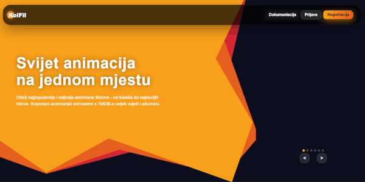
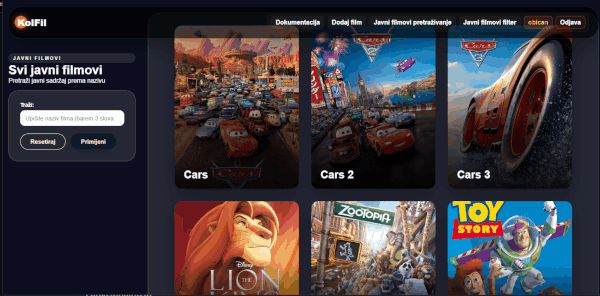
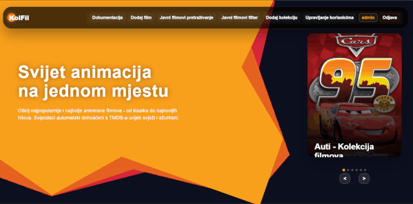

# KolFil - kolekcije animiranih filmova

Web aplikacija za istraživanje animiranih filmova i spremanje omiljenih naslova u kolekcije. Podaci o filmovima dohvaćaju se s TMDB API-ja, a korisnici mogu pregledavati detalje filmova, upravljati sadržajem kolekcija i ručno dodavati vlastite filmske zapise.

## Prikaz rada aplikacije

### Početna stranica


Prikazan je pregled početne stranice s filmovima i javnim kolekcijama.

### Registracija korisnika



Prikazan je postupak registracije novog korisnika unosom podataka u obrazac.

### Pregled filmova i kolekcija


Prikazano je pregledavanje filmova i kolekcija te otvaranje njihovih detalja.

### Javni filmovi i korisnički profil



Prikazano je pregledavanje javnih filmova i korisničkog profila s pripadajućim kolekcijama.

### Administratorsko upravljanje korisnicima



Prikazano je administratorsko sučelje za pregled korisnika, upravljanje blokadom računa i promjenu korisničkih uloga.

## O projektu

Projekt je izrađen u sklopu kolegija **Razvoj web aplikacija** na Fakultetu organizacije i informatike, prema zadatku „Upravljanje multimedijskim kolekcijama”. Prva faza obuhvaća REST servis i bazu podataka, a druga Angular klijent, doradu sučelja i dodatne funkcionalnosti.

## Funkcionalnosti

- Pretraživanje filmova putem TMDB API-ja i prikaz najbolje ocijenjenih animiranih filmova.
- Pregled detalja filma, uključujući opis, datum premijere, žanrove, ocjene i dostupne slike i videozapise.
- Spremanje filmova u kolekcije i uklanjanje filmova iz kolekcija.
- Javne i privatne kolekcije te određivanje javnosti filmskih zapisa.
- Ručni unos vlastitih filmskih zapisa s metapodacima.
- Pretraživanje javnih filmova po nazivu, uz najmanje tri unesena znaka.
- Filtriranje javnih filmova prema rasponu ocjena te sortiranje prema datumu premijere i broju glasova.
- Poslužiteljsko straničenje rezultata pretraživanja i filtriranja.
- Registracija, aktivacija računa e-poštom, prijava i odjava uz korisničke sesije.
- Blokiranje računa nakon tri pogrešna pokušaja prijave.
- Administracija korisnika i njihovih uloga.

### Korisničke uloge

| Uloga | Mogućnosti u sučelju |
| --- | --- |
| Gost | Pregled javnih kolekcija i javnog sadržaja, registracija, prijava i pristup dokumentaciji. |
| Registrirani korisnik | Pretraživanje TMDB-a, pregled detalja, dodavanje filmova, rad s kolekcijama te pregled vlastitog profila i pripadajućih kolekcija. |
| Moderator | Dodatno kreiranje kolekcija i dodjeljivanje korisnika kolekcijama. |
| Administrator | Dodatno pregled korisnika, blokiranje i odblokiranje računa te promjena uloge između korisnika i moderatora. |

## Tehnologije

| Dio projekta | Tehnologije |
| --- | --- |
| Klijentska aplikacija | Angular 20, TypeScript, HTML, SCSS |
| Poslužitelj | Node.js, Express 5, TypeScript |
| Baza podataka | SQLite |
| Komunikacija | REST API, JSON, Fetch API |
| Prijava i sesije | express-session, cookie-parser |
| Aktivacija računa | Nodemailer |
| Vanjski izvor podataka | TMDB API |
| Dizajn sučelja | Figma |

## Arhitektura i struktura

Angular klijent komunicira s REST servisom na putanji `/api`. Servis pristupa SQLite bazi i dohvaća podatke s TMDB-a. Izgrađenu Angular aplikaciju poslužuje isti Express poslužitelj.

```text
.
├── angular/
│   ├── projekti/zadaca2/
│   │   ├── public/          # Slike i konfiguracija klijenta
│   │   └── src/app/         # Stranice, komponente i servisi
│   ├── angular.json
│   └── package.json
├── posluzitelj/
│   ├── src/
│   │   ├── servis/         # REST resursi, DAO klase i TMDB klijent
│   │   ├── servisI/        # TypeScript sučelja
│   │   ├── zajednicko/     # Konfiguracija, baza i pomoćne funkcije
│   │   └── server.ts
│   ├── podaci/             # SQLite baza i lokalna konfiguracija
│   ├── build/              # Generira se kompiliranjem poslužitelja
│   ├── angular/            # Odredište izgradnje Angular aplikacije
│   └── package.json
└── dokumentacija/          # Izvorni zadaci kolegija u PDF obliku
```

## Lokalno pokretanje

### Preduvjeti

- Node.js kompatibilan s Angularom 20: `^20.19.0`, `^22.12.0` ili `>=24.0.0`, uz npm.
- Vlastiti TMDB API ključ v3 i pristupni token v4.
- Postojeća baza `posluzitelj/podaci/RWA2025nkihas23.sqlite`, uključena u repozitorij. Aplikacija ne kreira automatski shemu baze.
- Za aktivaciju novih računa potrebno je podesiti SMTP slanje u datoteci `posluzitelj/src/zajednicko/mail.ts` vlastitim podacima.

### 1. Instalacija ovisnosti

Iz korijenske mape projekta:

```sh
cd posluzitelj
npm install
cd ../angular
npm install
```

Skripta `npm run pripremi` namijenjena je nastavnom okruženju s globalno instaliranim modulima i koristi `npm link`. Za lokalnu instalaciju koristi se `npm install` u obje mape.

### 2. Konfiguracija poslužitelja

Kreirati datoteku `posluzitelj/podaci/konfiguracija.csv`. Svaki parametar upisuje se u zaseban red, u obliku `naziv$vrijednost`:

```text
tajniKljucSesija$OVDJE_UNESI_VLASTITI_TAJNI_KLJUC
stranicaLimit$20
tmdbApiKeyV3$OVDJE_UNESI_TMDB_API_KLJUC_V3
tmdbApiKeyV4$OVDJE_UNESI_TMDB_PRISTUPNI_TOKEN_V4
```

Zamijeniti ogledne vrijednosti vlastitima. Tajni ključ sesije mora imati **100 do 200 znakova** sastavljenih od malih slova, brojki te znakova `!` i `%`. Vrijednosti ne smiju sadržavati `$`, jer služi kao razdjelnik. `stranicaLimit` mora biti broj od **10 do 50**, a oba TMDB polja moraju biti popunjena da bi poslužitelj prihvatio konfiguraciju.

Konfiguracija poslužitelja isključena je iz Gita. Klijentska datoteka `angular/projekti/zadaca2/public/config.json` sadrži adresu REST servisa:

```json
{
  "restServis": "http://localhost:12222/api"
}
```

### 3. Izgradnja i pokretanje

Iz mape `angular` izgraditi klijentsku aplikaciju, a zatim kompilirati i pokrenuti poslužitelj:

```sh
npm run build
cd ../posluzitelj
npm run compile
npm start
```

Angular se izgrađuje u `posluzitelj/angular`, a TypeScript poslužitelja u `posluzitelj/build`.

Aplikacija je dostupna na **http://localhost:12222**, a dokumentacija unutar aplikacije na **http://localhost:12222/dokumentacija**.

Za pokretanje s drugom konfiguracijom ili portom, iz mape `posluzitelj`:

```sh
npm run zadaca -- podaci/konfiguracija.csv 12222
```

Ako se port promijeni, potrebno je uskladiti adresu u klijentskom `config.json` i ponovno izgraditi klijent.

### Razvojni način rada

Pokrenuti REST servis iz mape `posluzitelj`:

```sh
npm run compile
npm start
```

U drugom terminalu, iz mape `angular`:

```sh
npm start
```

Angular razvojni poslužitelj dostupan je na **http://localhost:4200**. REST servis treba ostati pokrenut na portu `12222`, prema adresi iz `config.json`.

## Dokumentacija
- [ERA model baze podataka](angular/projekti/zadaca2/public/slike/ERA-model-Nikola%20Kihas.png)

Stranica `/dokumentacija` sadrži pregled implementiranih REST ruta, funkcionalnosti i ograničenja rješenja.

## Poznata ograničenja

Prema dokumentaciji implementacije:

- Prijenos novih slika nije dovršen; spremanje putanje ne znači i spremanje slikovne datoteke na poslužitelj.
- Potpuno brisanje sadržaja iz baze nije dovršeno.
- Dodjeljivanje korisnika kolekcijama postoji, ali dodavanje filmova nije ograničeno samo na kolekcije kojima je korisnik dodijeljen.
- Dodatne funkcionalnosti poput JWT zaštite i reCAPTCHA-e nisu implementirane; prijava koristi sesije.

## Autor

**Nikola Kihas** · Fakultet organizacije i informatike · Razvoj web aplikacija
